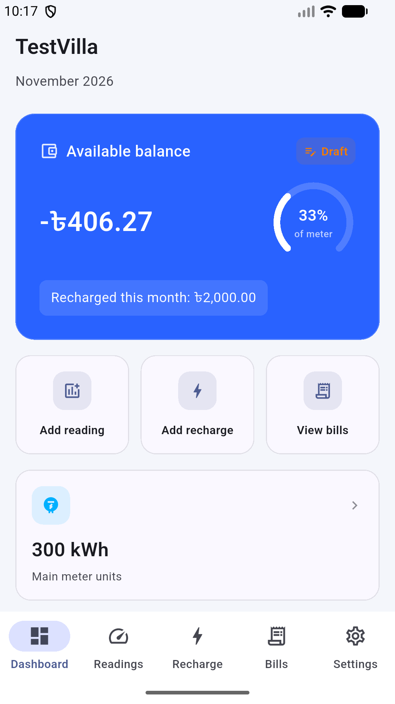
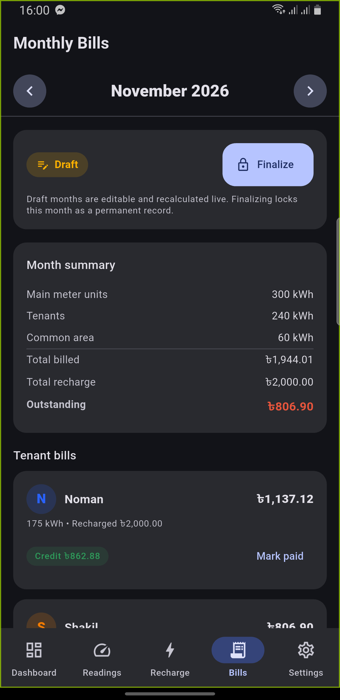
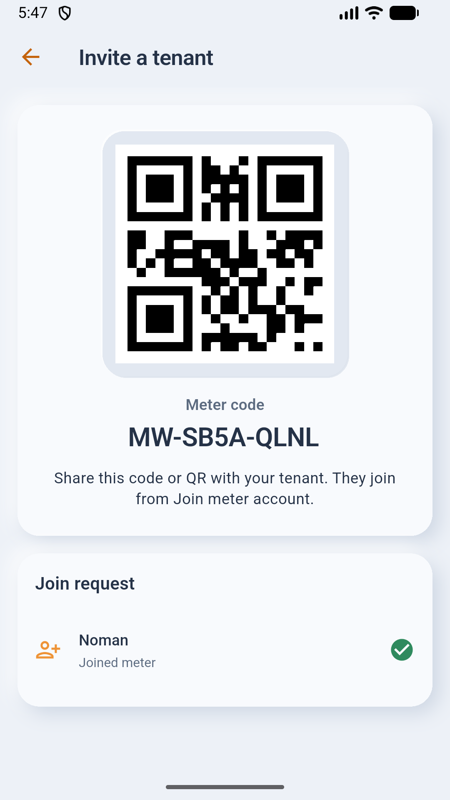
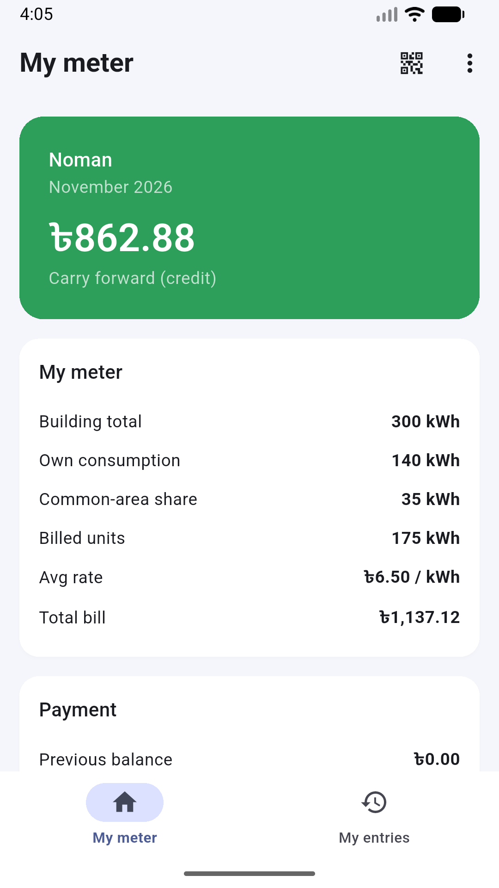
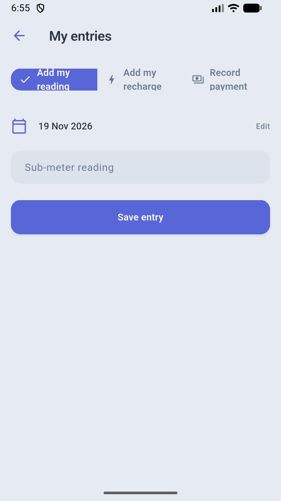
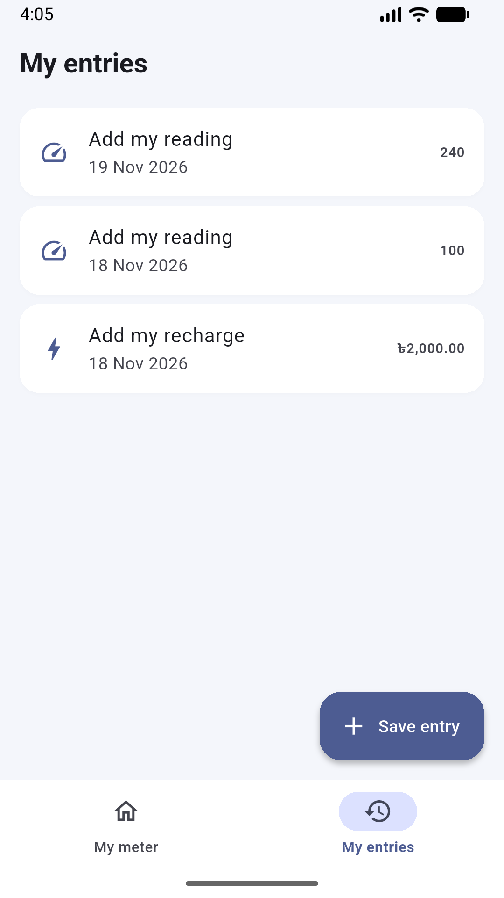
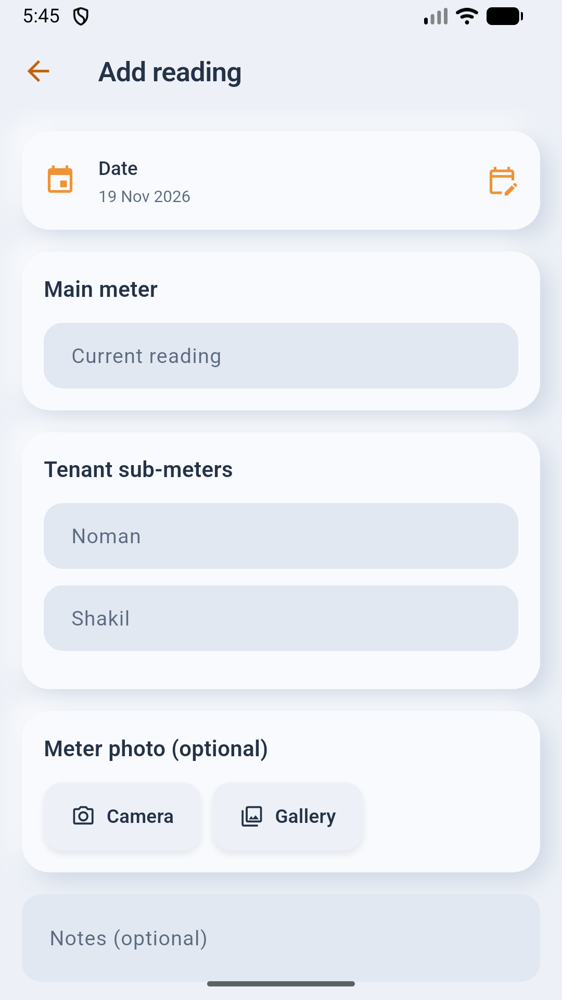
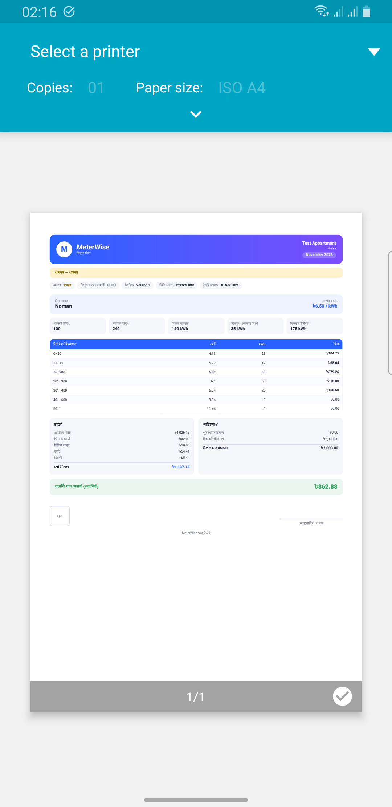

# MeterWise

[](https://github.com/wajedhossainbd/Meterwise/releases/latest)
[](https://github.com/wajedhossainbd/Meterwise/releases)
[](https://www.android.com/)
[](https://flutter.dev/)
[](test/)

**Smart Multi-Tenant Electricity Billing** — a Flutter Android app for prepaid
electricity billing in multi-tenant buildings in Bangladesh (DPDC-style tariffs).

## The core concept

One prepaid main meter feeds several tenant sub-meters. The landlord records
**only two things**: meter readings and recharges. MeterWise does the rest:

1. **Derives consumption** from closing − opening readings (common-area units
   are shared proportionally).
2. **Splits the DPDC slab tariff fairly** — every shared tenant gets an equal
   share of every slab; fixed-rate tenants are billed independently.
3. **Tracks the prepaid balance as a ledger** — recharges, tenant-to-tenant
   settlements, carry-forward between finalized months.
4. **Computes per-tenant bills** with demand charge, meter rent, fees, VAT and
   rebate, then freezes each month as an immutable snapshot.
5. **Produces professional invoices** in English and বাংলা, ready to share or print.

The billing math is a pure-Dart engine (`lib/features/billing/domain/billing_engine.dart`)
and is the single computation path for every surface. The owner's reference
spreadsheet is encoded as exact golden tests — see [BILLING.md](BILLING.md).

## Features

- 3-page onboarding tour; property / main meter / tenant setup with a dashboard checklist
- Reading sessions (main + per-tenant, photo, duplicate/lower-reading validation)
- Recharge log (energy credit, agent fee + expenses breakdown, receipt, payer chips)
- Settlements between tenants; draft → finalized accounting periods with hard immutability
- Tariff manager with official BERC/DPDC presets, versioning by effective date, clone/archive/preview
- Property-level calculation modes: shared slab (default), reconciled, fixed rate
- Dashboard with hero prepaid balance, interactive trends, quick actions and per-tenant rows
- Bills screen with month selector, finalize/unlock validation, mark-paid, full bill breakdown
- English vector PDF invoices and Bangla-capable HTML invoices
- en + bn localization (348 keys), light/dark theme, local zip backup and staged restore
- Adaptive NavigationBar (< 720px) / NavigationRail (≥ 720px)

## Screenshots

Real captures from the app running on device (Samsung S9+ and Pixel emulator).

| Landlord dashboard | Monthly bills and tenant split |
|---|---|
|  |  |

| Invite tenant by QR / code | Tenant-scoped home |
|---|---|
|  |  |

| Tenant self-entry | Tenant entry history |
|---|---|
|  |  |

| Meter reading session | Bengali PDF invoice |
|---|---|
|  |  |

## Architecture

Feature-first clean architecture:

```
lib/
├── core/          # constants, Drift database + migrations, router, theme, shared widgets
├── features/      # billing, dashboard, readings, recharge, settlements, tenants,
│                  # tariff, properties, main_meter, settings, onboarding
└── l10n/          # app_en.arb / app_bn.arb (+ generated localizations)
```

- State: Riverpod 3 (mixed generated + manual providers)
- Database: Drift/SQLite with reactive `watch()` streams
- Navigation: GoRouter with a 5-branch `StatefulShellRoute`
- Billing engine: pure Dart, no Flutter/Drift imports

Detailed architecture, schema, gotchas and test status live in
[HANDOFF.md](HANDOFF.md). Billing formulas live in [BILLING.md](BILLING.md).

## Building

Flutter 3.44.4 / Dart 3.12.2. On this machine Flutter is installed via Homebrew
but is **not** on the default PATH:

```bash
export PATH="/opt/homebrew/bin:$PATH"
export ANDROID_HOME="$HOME/Library/Android/sdk"
export ANDROID_SDK_ROOT="$HOME/Library/Android/sdk"

flutter analyze
flutter test --timeout=90s
flutter build apk --release
```

Codegen (after editing Drift tables or Freezed/model annotations):

```bash
dart run build_runner build          # note: no --delete-conflicting-outputs
flutter gen-l10n                     # after editing l10n/app_*.arb
```

Release APKs are copied to `archive/apks/` (kept on disk, git-ignored).
Before installing an upgrade on a device, back up from Settings → Backup.

## Release signing

Local release builds fall back to the debug key. For a Play Store upload, create
`android/key.properties` (git-ignored) and put the keystore in `android/app/`:

```
storeFile=upload-keystore.jks
storePassword=<password>
keyAlias=upload
keyPassword=<password>
```

Gradle picks it up automatically; without the file, local builds still work.

## Status

- Version **3.7.0+28**, database schema **v11**
- `flutter analyze`: clean · `flutter test`: **63 tests passing**
- Android only. Release APKs are signed with the keystore configured in
  `android/key.properties` (both git-ignored — back them up).
- Bangla invoices use a native Android channel that owns its WebView for the whole
  job (background thread, 20 s timeouts, guaranteed teardown, explicit A4/300 DPI
  print attributes). The generated PDF gets an `/Info` title stamped in so sharing
  apps show the invoice name instead of "Untitled". Verified on a Samsung S9+.
  The deprecated plugin converter and the English vector PDF remain as fallbacks,
  with a visible notice and retry if Bangla cannot be produced.
- Invoice language is configurable (auto / English / Bangla).
- **Tenant access:** landlord generates a meter code + QR from Settings → Invite a tenant; a tenant joins by scanning/entering the code and picking their roster name, then sees a scoped home with their usage, bill, balance, recharge history, invoices and an equal-split explanation. Approval happens on the landlord's device. Once joined, the first tab is the tenant's own home. Tenants can add their own sub-meter reading, log their own recharge, and record a manual payment or reimbursement to another tenant — all into the same ledger.
- Google Drive sync: landlord uploads an **AES‑256‑GCM encrypted** packet to their own Drive; tenant downloads, decrypts with the meter code and imports it. Tenants write their own entries back as encrypted `tenant_<name>.enc`, which the landlord picks up on next sync. An hourly WorkManager task runs both directions when online. OAuth client IDs are injected at build time from `.secrets/`. See `GOOGLE_DRIVE_SETUP.md`.

## Download / install

Grab the latest signed APK from the
[GitHub Releases page](https://github.com/wajedhossainbd/Meterwise/releases).
Enable "Install unknown apps" for your browser/file manager, install the APK,
then open the app. Upgrades preserve your local database (all migrations are
additive) — but still take a backup from **Settings → Backup** first.

## Documentation

| File | What it covers |
|---|---|
| [CHANGELOG.md](CHANGELOG.md) | Version-by-version release notes |
| [BILLING.md](BILLING.md) | Billing formulas and the spreadsheet-verified rules |
| [HANDOFF.md](HANDOFF.md) | Architecture, schema, gotchas, test status, **where work left off** |
| [GOOGLE_DRIVE_SETUP.md](GOOGLE_DRIVE_SETUP.md) | One-time Google Cloud OAuth setup for Drive sync |
| [PLAY_STORE.md](PLAY_STORE.md) | Play Store compliance checklist and remaining account-side actions |
| [STORE_LISTING.md](STORE_LISTING.md) | Ready-to-paste store listing copy |
| [DESIGN_SYSTEM.md](DESIGN_SYSTEM.md) | Brand tokens and component rules |

**Privacy policy:** https://wajedhossainbd.github.io/Meterwise/privacy.html

## Versioning and updates

- `pubspec.yaml` → `version: X.Y.Z+BUILD` is the single source of truth for
  Android `versionName` / `versionCode` (an incrementing `BUILD` is what makes
  Android offer an update).
- Keep `AppConstants.appVersion` in `lib/core/constants/app_constants.dart`
  in sync with the `X.Y.Z` part (shown in Settings).
- Update [CHANGELOG.md](CHANGELOG.md) and `README.md` status on every release.
- Build with the secrets injected (see below), then create a GitHub Release
  tagged `vX.Y.Z` and attach the APK so users get a downloadable update.

## Building with Drive sync

The OAuth client IDs are **not in the repository**. Put them in `.secrets/`
(git-ignored) as described in `GOOGLE_DRIVE_SETUP.md`, then:

```bash
CID=$(tr -d '\r\n' < .secrets/google_client_id.txt)
SID=$(tr -d '\r\n' < .secrets/google_server_client_id.txt)
flutter build apk --release \
  --dart-define=METERWISE_DRIVE_CLIENT_ID="$CID" \
  --dart-define=METERWISE_DRIVE_SERVER_CLIENT_ID="$SID"
```

That APK includes the in-app GitHub updater (enabled by default). For the
**Play Store AAB**, disable it — Play policy forbids apps updating themselves
outside the store:

```bash
flutter build appbundle --release \
  --dart-define=METERWISE_DRIVE_CLIENT_ID="$CID" \
  --dart-define=METERWISE_DRIVE_SERVER_CLIENT_ID="$SID" \
  --dart-define=METERWISE_GITHUB_UPDATER=false
```

A plain `flutter build apk --release` still works — Drive sign-in is simply
unavailable in that build.

This project is not published to pub.dev.
